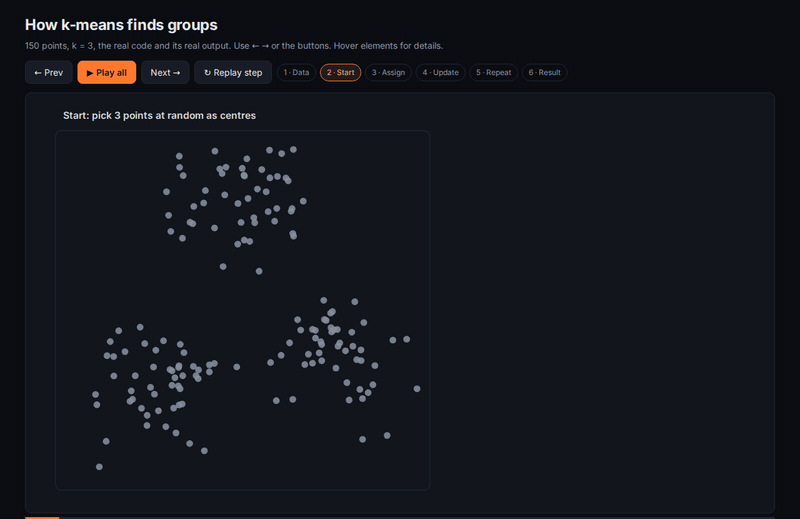

<h1 align="center">explain</h1>

<p align="center">
  <em>Point your agent at a pipeline. Get back an animated walk-through of what it actually does.</em>
</p>

<p align="center">
  
  
  
  
</p>

<p align="center">
  
</p>

<p align="center">
  <sub>The demo above is <a href="examples/kmeans">k-means in 31 lines of plain Python</a>, explained by the skill. Every number on screen comes from running that code.</sub>
</p>

---

You inherited a data pipeline, a scoring model, an optimiser. You can read it line by line, but you can't *see* it: which step throws rows away, where the numbers jump, which assumption everything rests on. And you can't critique what you can't see.

`explain` is a skill for Claude Code that reads the code, runs it, and builds a local page that animates each stage on the code's real output, with a plain-language caption, the exact line of code, and a box of pointed questions about that stage's weakest assumption.

## What you type

```
/explain the churn scoring pipeline in src/scoring
```

## What you get

- **One page, 5–9 stages,** in execution order. Each stage's title is the question it answers: *What goes in? Which rows are dropped? When does it stop?*
- **Real data, never retyped.** An `export.py` runs your code and dumps what the page draws to `data.json`, then asserts a headline number matches your code's own printout.
- **Animation that explains.** Points dropping into buckets, centres sliding to a mean, bars overflowing a limit in red: the before-and-after of each step, not a static chart.
- **Four boxes per stage:** *in plain words*, *what the code does* (with the real line), *terms*, and *open to critique*.
- **Hover anything** for its values. Arrow keys, Play all, and a `#N` link to every stage.

The critique box is the point. Every question in it has to come from something the code actually does: an unguarded division, a seed, a sort that breaks row alignment. Never a generic worry.

## How it works

```
1. Understand   → read the source end to end, run it once, list the real stages
2. Export       → export.py runs the code via runpy and writes data.json (NaN → null, one assert)
3. Build        → copy template.html, write one draw(g) per stage into an SVG
4. Verify       → serve on localhost, screenshot every stage, fix clipping and console errors
5. Share        → only if asked: index.html + data.json to any static host
```

After the code changes, re-run `export.py` and refresh. The page doesn't need edits.

## Install

Needs Python 3 (for `export.py` and a local server). The page itself is plain HTML, SVG and JavaScript: no build step, no libraries.

### Claude Code plugin

```
/plugin marketplace add Alexzcoder/explain-skill
```
```
/plugin install explain@explain-skill
```

### Or copy the folder

```bash
git clone https://github.com/Alexzcoder/explain-skill
cp -r explain-skill/skills/explain ~/.claude/skills/explain
```

Then type `/explain <what to explain>` in any project.

## Try the example

```bash
cd examples/kmeans
python3 export.py                 # runs kmeans.py → data.json
python3 -m http.server 8000       # open http://localhost:8000
```

| File | What it does |
|---|---|
| [`skills/explain/SKILL.md`](skills/explain/SKILL.md) | The workflow the agent follows |
| [`skills/explain/template.html`](skills/explain/template.html) | The player: stages, captions, tooltips, animation helpers |
| [`examples/kmeans/kmeans.py`](examples/kmeans/kmeans.py) | The code being explained |
| [`examples/kmeans/export.py`](examples/kmeans/export.py) | Runs it and writes `data.json` |
| [`examples/kmeans/index.html`](examples/kmeans/index.html) | The finished explainer, six stages |

## Use the template without the skill

Copy `template.html` next to a `data.json`, then replace the `STAGES` array. Each stage is:

```js
{name: '3 · Assign', title: 'Which group does each point join?', draw: s3,
 text: 'Plain words, no jargon.',
 tech: 'What the code does, precisely.',
 code: 'labels = [nearest(p, centres) for p in points]',
 words: [['Euclidean distance', 'Ruler distance between two points.']],
 critique: ['Distance in raw units: which axis would dominate?']}
```

`draw(g)` draws into an SVG (viewBox 1000 × 560) with small helpers: `S`/`T` for elements and text, `fade`, `draw` (stroke reveal), `tween` (eased motion), `later` (sequenced steps that cancel when you change stage), `tipOn` (tooltips), `legend`, `axisTitle`, `fmt`.

## What the skill already knows

Things that are slow to discover and are written into the skill, so the agent does not relearn them:

- `NaN` in JSON makes the browser reject the whole file and the page renders blank, silently. The export turns NaN into `null`.
- If the source re-sorts a table after building a positional array, rows stop matching. The export recomputes per-row values from the row itself.
- "It rendered" is not "it looks right". The agent screenshots every stage after its animation ends and reads them for clipped text and overlapping labels.
- The first animation frame can be timestamped before the animation starts, which makes eased motion jump backwards. The template clamps it.

## Limits

- The agent has to be able to run your code. If it needs credentials or a database, it explains from what it can reach and says so.
- One page explains one pipeline. Big systems become a few linked pages.
- Pictures are drawn by hand per stage, so a stage costs the agent real work: expect a few minutes per stage.
- Used on a data-harmonisation pipeline, an optimisation model, a pitch deck and the k-means example above.

## License

MIT. See [LICENSE](LICENSE).
